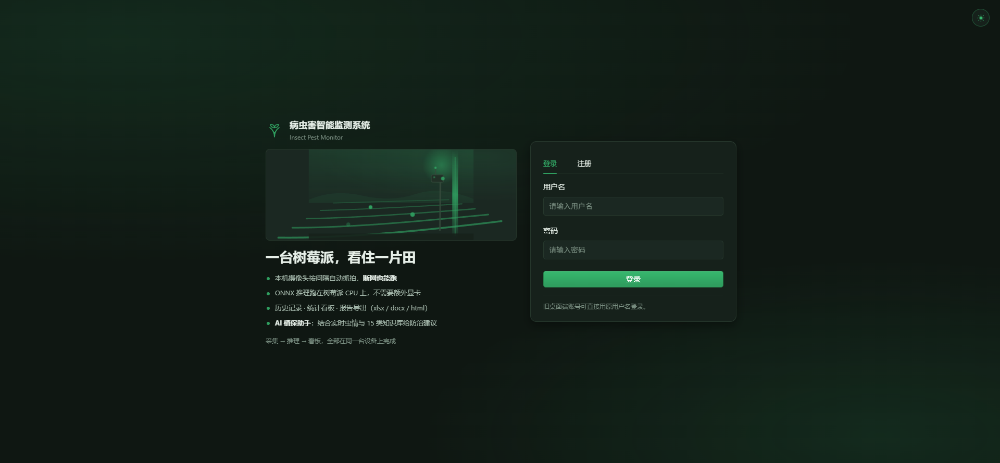
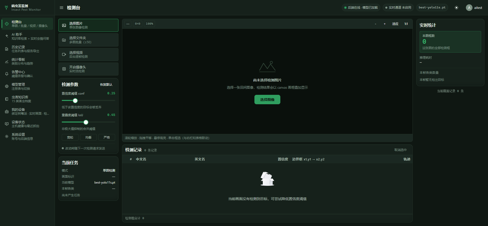
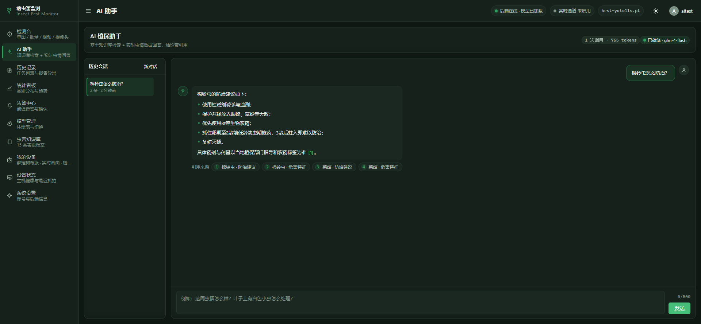
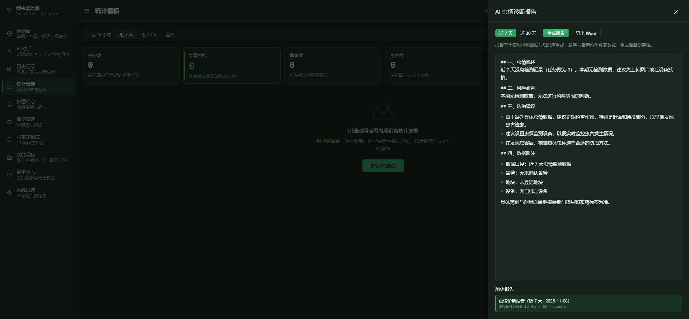
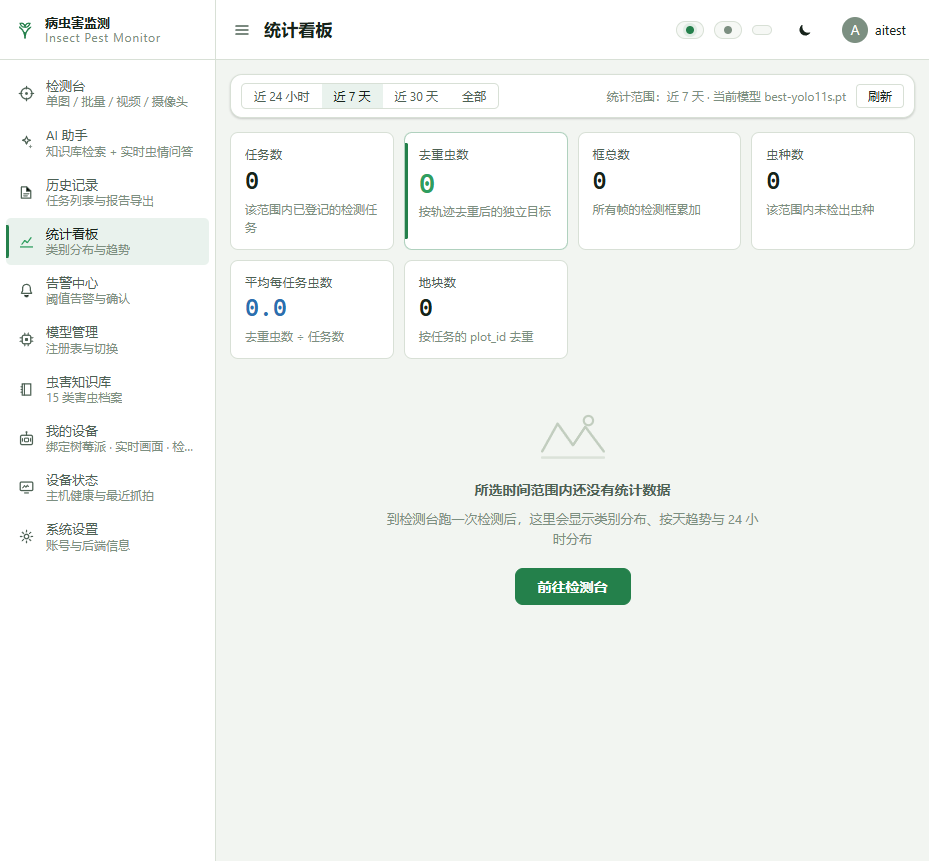
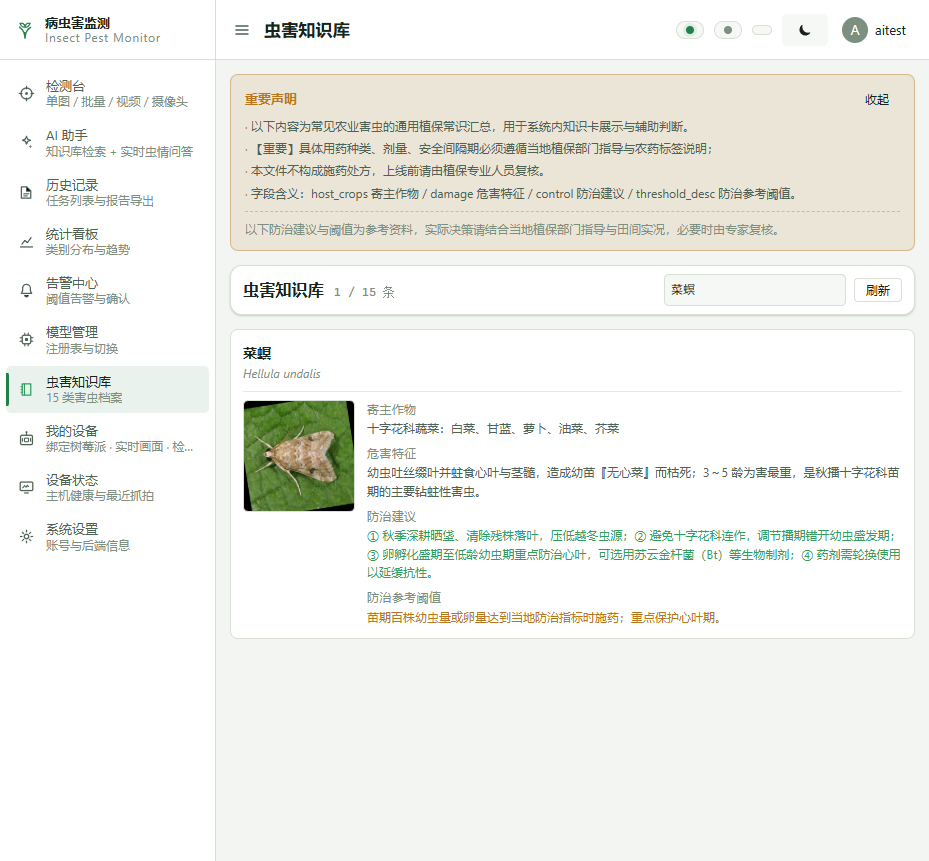
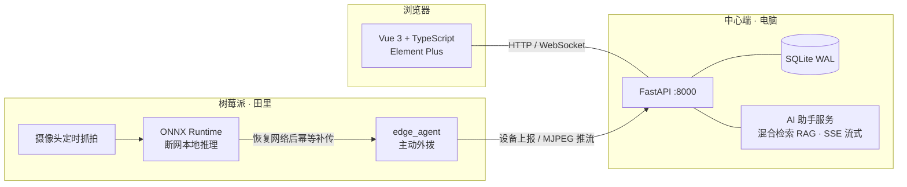

<div align="center">

# 病虫害智能监测系统

**一台树莓派，看住一片田 —— 边缘抓拍 · YOLO 检测 · RAG 植保助手**

[](https://github.com/Duron204/insect-pest-monitor/actions/workflows/ci.yml)
[](backend/tests)
[](vue-frontend/src)
[](LICENSE)

</div>

---

用一台树莓派 + 摄像头放在田里，自动抓拍并用 **YOLO11** 识别 15 类病虫害；
数据回传到中心端网页看板，支持实时检测、告警、统计与报告导出。
内置 **AI 植保助手**：词法 + 向量混合检索知识库，结合实时虫情数据流式回答，
结论带引用溯源，并可一键生成可导出 Word 的虫情诊断报告。

## 界面一览

| 登录（深色默认） | 检测台 |
|---|---|
|  |  |

| AI 助手（引用溯源 · 会话持久化 · 用量观测） | AI 诊断报告（看板一键生成） |
|---|---|
|  |  |

| 统计看板（浅色主题） | 虫害知识库（15 类档案） |
|---|---|
|  |  |

## 系统架构



**三个关键设计**：

1. **同一套后端代码，两种角色**——中心端 torch 推理；树莓派 `backend: onnx` + `agent.enabled: 1`
   作为边缘代理**主动外拨**连中心。换公网/4G 只改 `center_url` 一个值，无需 NAT 穿透。
2. **断网可用**——树莓派本地 ONNX 推理，网络恢复后按 seq 幂等补传，不丢不重。
3. **账号隔离**——任务/设备/告警/AI 会话全部按 `owner_id` 过滤，规则只写在 `services/ownership.py` 一处。

## 核心能力

| 能力 | 说明 |
|---|---|
| 图像检测 | 单图 / 批量 / 视频逐帧 / 浏览器摄像头 WebSocket 实时推理，框 + 类别 + 置信度 |
| 跟踪去重 | 同一只虫连续帧不重复计数（`unique_objects` 才是对外口径） |
| 边缘抓拍 | 树莓派直连摄像头定时抓拍，断网本地推理，恢复补传 |
| 设备管理 | 配对绑定、实时画面（MJPEG）、心跳诊断、结果上报 |
| 告警中心 | 按虫口密度阈值触发，红点提醒，确认处理 |
| 统计看板 | 类别分布 / 时段分布 / 趋势曲线（手写 SVG 图表，零 ECharts 依赖） |
| **AI 植保助手** | **混合检索 RAG（词法+向量，熔断降级）· 实时数据注入 · SSE 流式 · 引用溯源** |
| **对话持久化** | 会话与消息落库（含 token / 延迟 / 模型记账），刷新不丢 |
| **LLM 用量观测** | 调用次数 / token / 平均延迟按账号聚合，看板一键可见 |
| **诊断报告** | 数据+知识 → 结构化报告（流式生成、快照存档、导出 Word） |
| 报告导出 | 检测报告 xlsx / docx / html；AI 报告 docx |
| 账号体系 | 注册 / 登录 / JWT / bcrypt；票据化媒体访问，路径穿越防护 |

## AI 助手：检索与可靠性设计

| 决策 | 理由 |
|---|---|
| **词法 + 向量混合检索** | 词法路（中文名/寄主词/bigram）擅长精确直呼；向量路（GLM embedding-3 余弦）擅长口语化语义。融合：`lexical + 4.0 × max(cos − 0.35, 0)`，死区滤掉底噪相似度 |
| **向量服务熔断降级** | embedding 服务失败自动降级纯词法；连续失败后 5 分钟熔断，不打无效请求。**检索可用性不依赖外部服务** |
| **embedding 本地缓存** | 语料向量带指纹缓存到 `backend/data/ai_embeddings.json`，语料/模型变更自动重算 |
| **引用溯源** | 检索块带 `[n]` 编号写进提示词；回答中的 `[n]` 与引用徽标可点击，直达知识库卡片 |
| **反幻觉守卫** | 空数据上下文显式写"没有检测记录"；system 约束数字只能来自实时数据 |
| **用量记账** | 每次调用 token/耗时/模型落库（`ai_messages` 兼作记账行），按账号聚合 |

## 技术栈

**后端**：Python 3.11+ · FastAPI · SQLAlchemy 2.0 (SQLite WAL) · PyJWT/bcrypt · httpx
**AI**：Ultralytics YOLO11s / YOLOv8s · PyTorch（训练/主机）· ONNX Runtime（边缘）· OpenAI 兼容 LLM 协议（智谱 GLM / DeepSeek / Ollama）
**前端**：Vue 3 · TypeScript · Vite · Pinia · Element Plus · Vitest · vue-tsc
**部署**：GitHub Actions CI（双 job）· systemd 看门狗 · PowerShell/Bash 一键脚本

## 快速开始

```powershell
# 1) 后端（Python 3.11+）
pip install -r backend/requirements.txt -c backend/constraints.txt
start_backend.bat          # 或: cd backend && python -m app.main

# 2) 前端开发模式（可选）
cd vue-frontend
npm install
npm run dev                # Vite :3000，代理 /api 到 :8000

# 生产模式：后端直接托管前端构建产物（单端口 8000，免 CORS）
build_frontend.bat
```

**AI 助手**（不配置不影响其他功能）：`config.yaml` 的 `ai` 段填好 `base_url` 与
`model`，再设置环境变量 `INSECT_AI_API_KEY`（智谱 / DeepSeek 等 OpenAI 兼容服务均可）。

**树莓派部署**：见 [deploy/README-pi.md](deploy/README-pi.md)（systemd + 看门狗 + 维护定时器）。

## 测试与质量

```powershell
cd backend  && python -m pytest tests/ -q     # 440 项（含 36 项 AI 专项）
cd vue-frontend && npm run test               # 107 项
cd vue-frontend && npm run build              # 含 vue-tsc 类型检查
```

- 检索质量：18 条黄金问题集（口语问法 → 期望物种），hit@3 = 100%
- 融合/死区/缓存/熔断/降级：`test_ai_vector.py` 专项覆盖
- 归属隔离：别人的会话/报告/设备一律 404（不确认存在性）
- CI：每次 push 跑后端全量 + 前端类型检查/单测/构建；权重与数据集不进仓库，依赖真模型的用例显式 skip

## 文档索引

| 文档 | 内容 |
|---|---|
| [项目文档.md](项目文档.md) | 架构 / 目录 / 启动 / 部署 / 安全 / 运维（总入口） |
| [AI助手设计方案.md](AI助手设计方案.md) | RAG 检索设计 / 流式协议 / 评估方案 |
| [deploy/README-pi.md](deploy/README-pi.md) | 树莓派安装、自检清单、常见问题 |

## 数据与模型

- 15 类农业害虫（菜螟、棉铃虫、白粉虱、蚜虫等），YOLO11s 主力 + YOLOv8s 对照
- 主力模型 mAP@0.5 ≈ 0.94（以最佳 checkpoint 实测为准）
- 知识库为通用植保常识汇编，标注"不构成施药处方"；权重与数据集图像不进仓库（`.gitignore`）

## License

MIT —— 见 [LICENSE](LICENSE)
